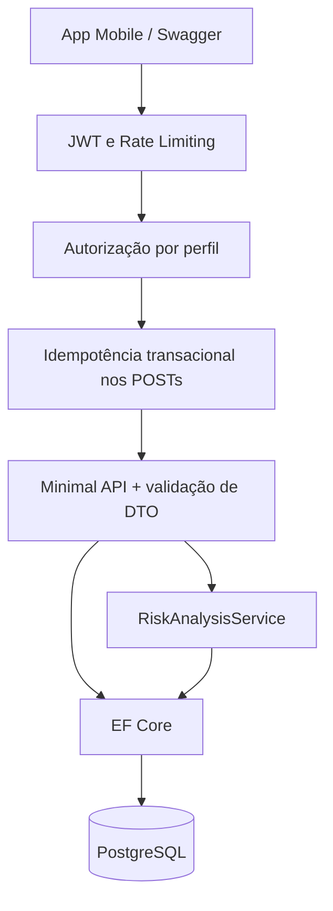

# Arquitetura da AgroConecta

As entidades originais e seus relacionamentos foram mantidos: User 1:N Farm; Farm 1:N CropArea; CropArea 1:N Sensor, SatelliteData e ClimateAlert; Sensor 1:N SensorReading; ClimateAlert 1:N Recommendation.

`IdempotencyRecord` armazena a resposta de uma operação concluída. O middleware abre uma transação do mesmo DbContext usado pelo handler. No PostgreSQL, um advisory lock por chave impede que duas instâncias executem a mesma operação ao mesmo tempo. O hash da chave combina conta, rota e cabeçalho; o hash da requisição combina método, query string e corpo JSON. Isso garante igualdade do corpo recebido, sem canonicalização semântica de JSON.

O JWT identifica a conta e seu perfil; não contém senha. A aplicação usa `PasswordHasher<User>` do ASP.NET Core, sem criptografia reversível. O cadastro público nunca escolhe o perfil ADMIN. O modelo de autorização é por função dentro de uma cooperativa, com dados agrícolas compartilhados. Uma evolução para várias cooperativas exige um identificador de organização e filtros/validações de acesso em todas as consultas e escritas.

O erro interno é registrado no log com um traceId e devolve uma mensagem genérica. Erros de vínculo e duplicidade no PostgreSQL retornam conflito. As navegações inversas são ignoradas no JSON para evitar ciclos de serialização.

`/health/live` verifica se o processo responde. `/health/ready` e `/health` testam a conexão com o banco. O banco é a única dependência externa da API.

SQLite permite demonstração e integração HTTP sem PostgreSQL. Ele não substitui a validação do SQL/migrations/advisory locks do PostgreSQL. O rate limiter é local a cada instância.
